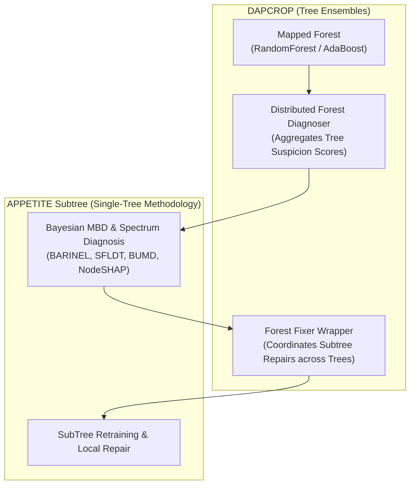

# DAPCROP: Domain Adaptation and Concept Drift Repair for Tree Ensembles

[](https://opensource.org/licenses/MIT)
[](https://www.python.org/downloads/)
[](https://proceedings.mlr.press/)

**DAPCROP** is a framework for **diagnosing and repairing Tree Ensemble models (Random Forests, AdaBoost) under concept drift**.

Building upon the single-tree diagnostic and repair foundations established in [APPETITE](https://github.com/yoavzelinger/APPETITE), DAPCROP scales Model-Based Diagnosis (MBD) and localized subtree repair to ensemble classifiers. Rather than retraining entire forests from scratch when data distributions change, DAPCROP maps and distributes fault diagnosis across individual constituent estimators, performing targeted subtree refitting and weight adjustment across the ensemble.

---

## Architecture & Relationship with APPETITE



DAPCROP embeds the core single-tree methodology directly via git subtrees:
* [`Methodology/APPETITE/`](file:///Users/yoavzelinger/dev/academic/github.com/DAPCROP/Methodology/APPETITE/): Base diagnostic algorithms and tree-repair primitives synchronized from APPETITE.
* [`Evaluation/SingleModel/`](file:///Users/yoavzelinger/dev/academic/github.com/DAPCROP/Evaluation/SingleModel/): Single-tree evaluation runners and dataset management tools.

---

## Key Capabilities

* **Ensemble Model Mapping**: Maps scikit-learn `RandomForestClassifier` and `AdaBoostClassifier` ensembles into structured graph components (`MappedForest`).
* **Distributed Forest Diagnosis**: Evaluates fault suspectability across all ensemble trees in parallel or via distributed consensus.
* **Ensemble Fixer Wrappers**: Coordinates local subtree retraining (`ForestFixerWrapper`, `DependentForestFixerWrapper`) across affected estimators, re-aligning ensemble predictions without full retraining.
* **Benchmark Evaluation**: Supports Feature-Shift, Distribution-Edge, and MOA-Stream drift scenarios evaluated against retrained forest baselines.

---

## Installation

### Prerequisites
* Python $\ge$ 3.10

### Setup
```bash
# 1. Clone the repository
git clone https://github.com/yoavzelinger/DAPCROP.git
cd DAPCROP

# 2. Create and activate a virtual environment
python -m venv .venv
source .venv/bin/activate

# 3. Install dependencies in editable mode
pip install -e .
```

Alternatively, install dependencies via `requirements.txt`:
```bash
pip install -r requirements.txt
```

---

## Quickstart & Evaluation

### 1. Run Benchmark Suite
Run the evaluation suite across all benchmark datasets:
```bash
python test_all.py
```

### 2. Configure Drifting Model Type
In [`Methodology/Constants.py`](file:///Users/yoavzelinger/dev/academic/github.com/DAPCROP/Methodology/Constants.py), configure the target ensemble architecture:
```python
# Options: DriftingModel.RandomForest, DriftingModel.AdaBoost, DriftingModel.DecisionTree
DRIFTING_MODEL = DriftingModel.RandomForest
```

### 3. Command-Line Options
The evaluation entry point accepts the same command-line flags as the single-model evaluator:
```bash
python -m Evaluation.SingleModel.evaluator --drift-type feature_shift -c 5
```

---

## How to Extend DAPCROP

### 1. Adding an Ensemble-Level Fixer or Policy
Create an ensemble fixer wrapper in [`Methodology/Fixers/`](file:///Users/yoavzelinger/dev/academic/github.com/DAPCROP/Methodology/Fixers/):
```python
from Methodology.Fixers.ForestFixerWrapper import ForestFixerWrapper

class CustomForestFixer(ForestFixerWrapper):
    def fix(self, mapped_forest, diagnosis, X_repair, y_repair):
        """
        Coordinates repairs across estimators in the mapped forest.
        """
        # Implement custom forest-level repair / weight tweaking
        return super().fix(mapped_forest, diagnosis, X_repair, y_repair)
```

### 2. Benchmarking on Your Own Data
1. Place your CSV dataset into `data/Classification_Datasets/<dataset_name>.csv`.
2. Add its relative path to [`data/all_datasets.csv`](file:///Users/yoavzelinger/dev/academic/github.com/DAPCROP/data/all_datasets.csv).
3. Run the evaluation specifying your dataset:
   ```bash
   python -m Evaluation.SingleModel.evaluator -t <dataset_name>
   ```

---

## Subtree Synchronization with APPETITE

For developers making changes to the shared tree methodology or single-model evaluation suites:
* Make foundational single-tree changes in the **[APPETITE](https://github.com/yoavzelinger/APPETITE)** repository.
* Propagate changes to DAPCROP using the subtree synchronization script:
  ```bash
  /path/to/sync-subtrees.sh appetite-to-dapcrop
  ```

---

## Citation

If you use DAPCROP in your research, please cite our paper:

```bibtex
@inproceedings{zelinger2026structural,
  title={Structural Drift Repair in Decision Trees via Bayesian Model-Based Diagnosis},
  author={Zelinger, Yoav and Kalech, Meir},
  booktitle={Proceedings of the 42nd Conference on Uncertainty in Artificial Intelligence},
  series={Proceedings of Machine Learning Research},
  volume={337},
  pages={7992--8005},
  year={2026},
  publisher={PMLR}
}
```

---

## License

This project is licensed under the **MIT License** — see the [LICENSE](LICENSE) file for details.
